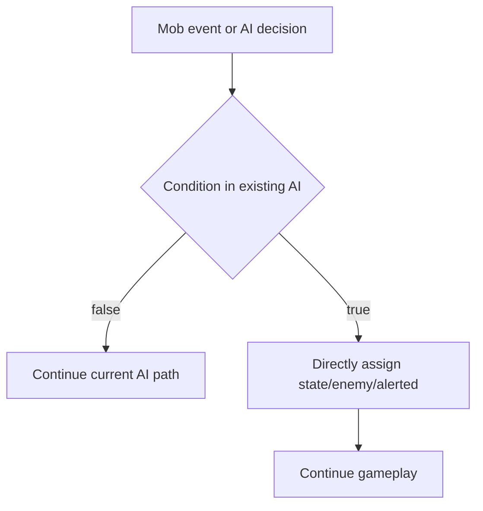
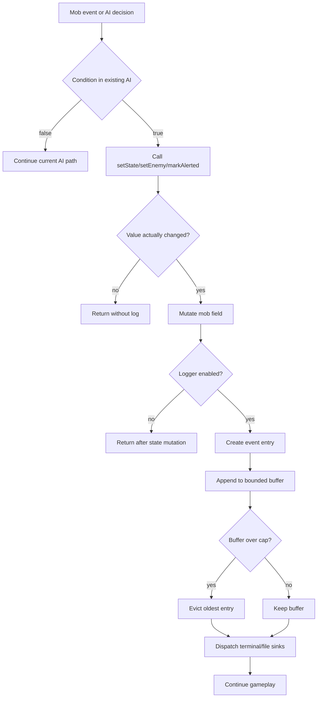
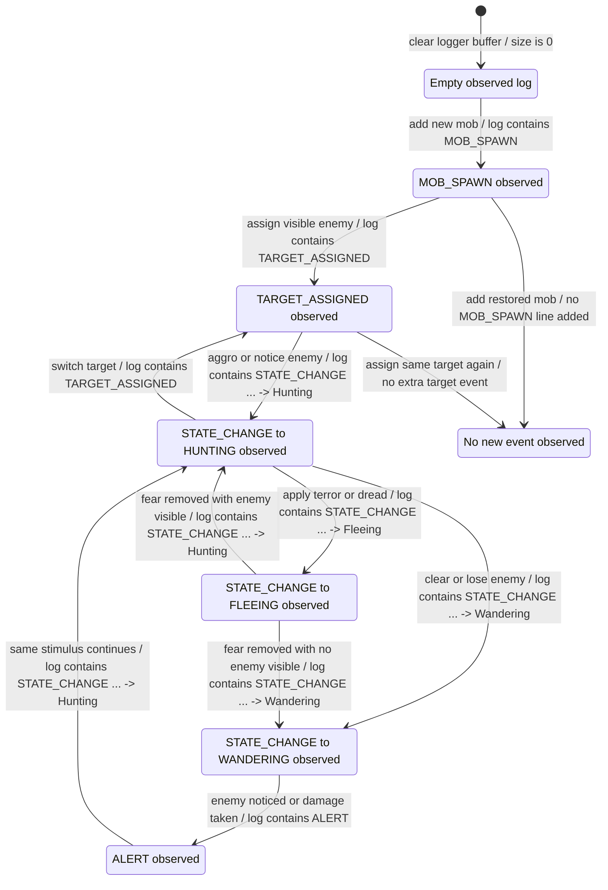
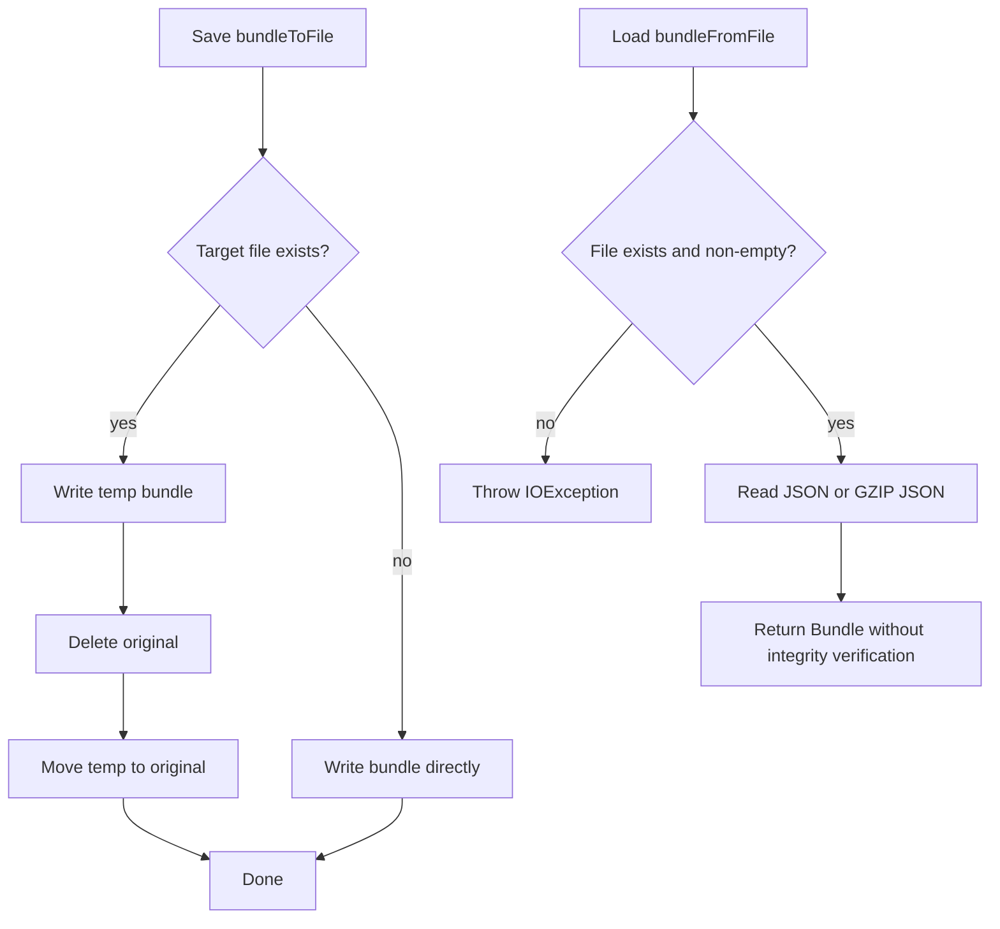
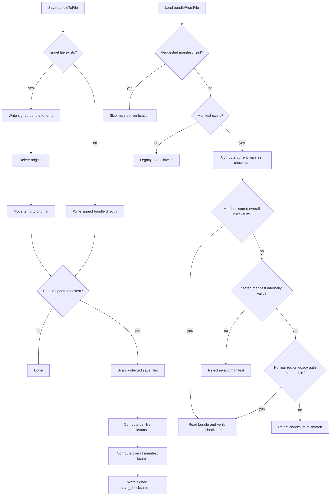
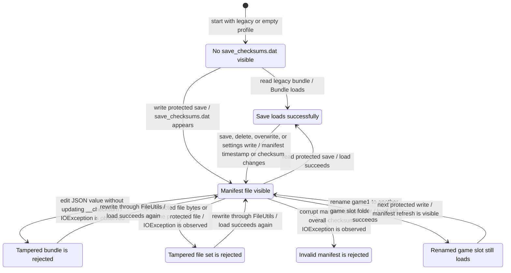
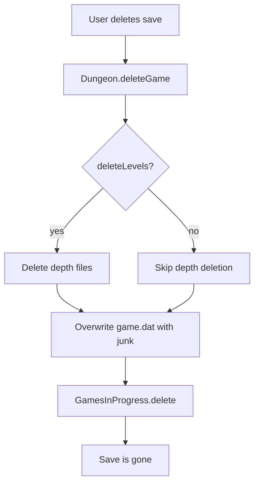
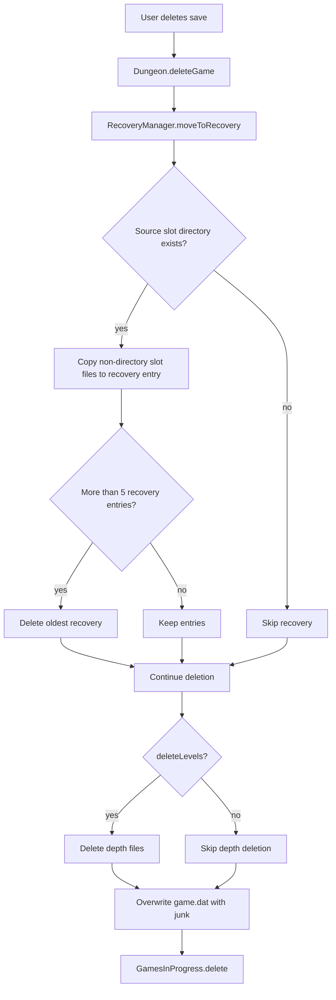
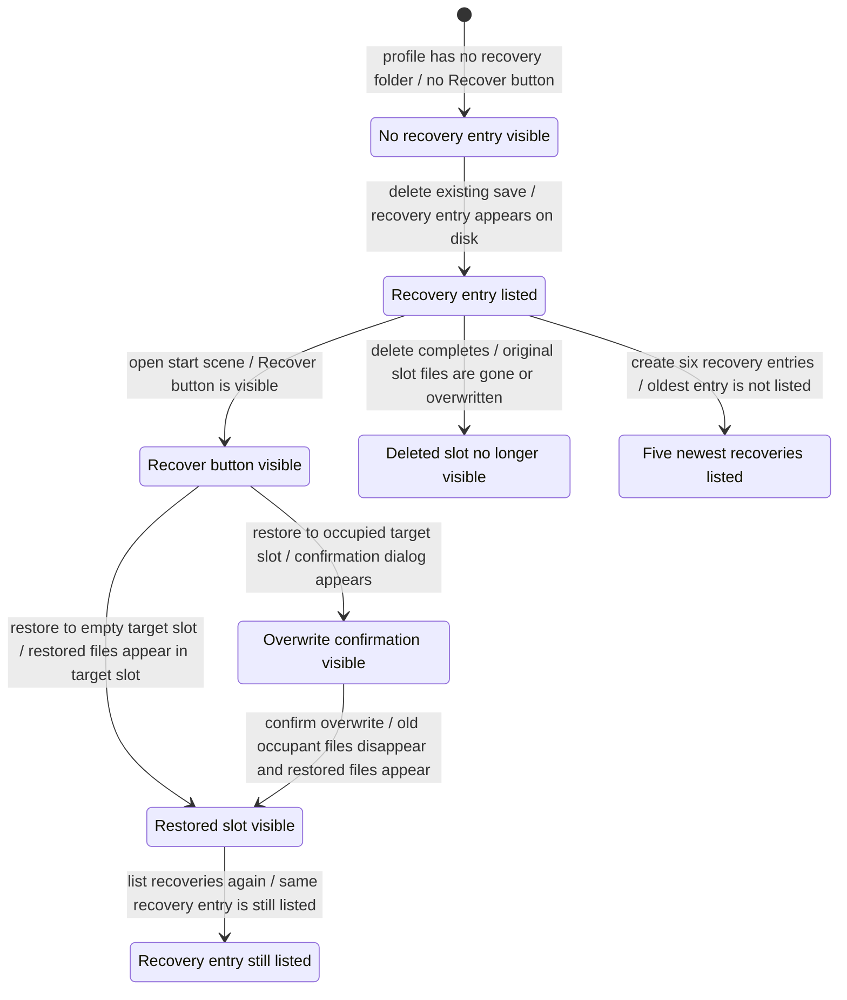

# Feature Complexity and Test Path Report

Project: `shattered-pixel-dungeon-3.0.2`  
Report scope: the three newly added Assignment 3 features, each compared against the first parent of the merge commit that introduced that feature.

Benchmark points:

| Feature | Feature merge | Benchmark parent | Main changed production files |
|---|---:|---:|---|
| Mob behaviour logging | `7a72358` | `7a72358^1` | `Mob.java`, `MobBehaviourLogger.java` |
| Save integrity checksum | `43c6f42` | `43c6f42^1` | `Bundle.java`, `FileUtils.java`, `GameSettings.java`, `CrashReportWriter.java` |
| Recovery saves | `7811326` | `7811326^1` | `Dungeon.java`, `RecoveryManager.java`, `StartScene.java`, `WndRecoverySave.java` |

Cyclomatic complexity is reported as `V(G) = decisions + 1`. Current method values are aligned with JaCoCo complexity where available. For files/classes that did not exist in the benchmark, the original complexity is `0`.

## 1. Mob Behaviour Logging

### Feature Summary

The benchmark implementation mutated mob AI state directly:

- `state = HUNTING`, `state = WANDERING`, `state = FLEEING`, `state = SLEEPING`
- `enemy = ...`
- `alerted = true`

The feature adds `MobBehaviourLogger` plus helper methods in `Mob`:

- `setState(AiState newState, String reason)`
- `setEnemy(Char newEnemy, String reason)`
- `markAlerted(String trigger)`

The existing AI decision structure is intentionally preserved. Most existing mob methods have the same branch structure, but mutation sites now pass through helper methods that add no-op checks and event emission.

### Changed Files and Implementation

Line deltas are from `git diff --numstat 7a72358^1 7a72358`. Text total: 1,593 additions and 33 deletions, plus one binary PDF test plan.

| Changed file | Lines added | Lines deleted | Purpose |
|---|---:|---:|---|
| `.gitignore` | 1 | 0 | Ignore generated local artifacts. |
| `build.gradle` | 8 | 2 | Add feature-test and reporting build support. |
| `core/build.gradle` | 127 | 0 | Configure core test, integration-test, and JaCoCo feature coverage tasks. |
| `core/src/main/java/com/shatteredpixel/shatteredpixeldungeon/actors/mobs/Mob.java` | 64 | 31 | Route mob state, target, alert, and spawn changes through logging helpers. |
| `core/src/main/java/com/shatteredpixel/shatteredpixeldungeon/actors/mobs/MobBehaviourLogger.java` | 214 | 0 | Add the event logger, sinks, formatting, and bounded buffer. |
| `core/src/test/java/com/shatteredpixel/shatteredpixeldungeon/actors/mobs/MobBehaviourLoggerTest.java` | 465 | 0 | Unit coverage for logger state, formatting, sinks, null handling, and buffer bounds. |
| `core/src/test/java/com/shatteredpixel/shatteredpixeldungeon/actors/mobs/MobBehaviourLoggerPerformanceTest.java` | 119 | 0 | Performance guards for disabled logging, enabled events, and buffer eviction. |
| `core/src/integrationTest/java/com/shatteredpixel/shatteredpixeldungeon/actors/mobs/MobBehaviourLoggerIntegrationTest.java` | 217 | 0 | Integration coverage for `Mob` instrumentation paths. |
| `doc/mob-behaviour-logging/cc_analysis.md` | 184 | 0 | Complexity analysis notes. |
| `doc/mob-behaviour-logging/implementation_work_plan.md` | 194 | 0 | Implementation plan notes. |
| `doc/mob-behaviour-logging/test_plan.pdf` | binary | binary | Test-plan artifact. |

Implementation paragraph: mob behaviour logging is implemented as an observational layer around existing mob state mutation points. `MobBehaviourLogger` is a singleton with four public event APIs (`logSpawn`, `logStateChange`, `logAlert`, and `logTarget`) that append immutable entries to a capped in-memory buffer, format each event, and dispatch it to terminal and file sinks while swallowing sink failures. `Mob` keeps its existing AI branches, but direct assignments are replaced with `setState`, `setEnemy`, and `markAlerted` helpers that suppress duplicate/no-op events and emit log entries only when the observed mob state actually changes. Spawn logging is placed inside the existing `firstAdded` branch in `onAdd`, so restored mobs do not produce duplicate spawn events.

### Changed Function Complexity

Important scope note: the mob behaviour logging feature does not add new decision points to the original AI state-machine logic. The existing `Mob` behaviours still make the same gameplay decisions as the benchmark; most changes replace direct field assignments with helper calls. The cyclomatic complexity increase is in newly added observational helpers and logger methods, not in the original AI control flow itself.

| Function or method group | Original V(G) | New V(G) | Increase | Analysis |
|---|---:|---:|---:|---|
| Existing `Mob` AI decision methods such as `act`, `chooseEnemy`, `Wandering.act`, `Hunting.act`, and `Fleeing.act` | unchanged | unchanged | 0 | Direct assignments were replaced by helper calls, but the gameplay branches and transitions remain the same. |
| Direct `state = ...` assignment sites in `Mob` | assignment only | delegated to `setState` | 0 in caller | Original sites had no local decision branch. The caller still follows the same path; helper complexity is counted separately. |
| `Mob.setState` | 0 | approx. 4 | +4 new helper | New observational helper. Paths: unchanged state return; changed state with non-null names; changed state with null old or new state. |
| Direct `enemy = ...` assignment sites in `Mob` | assignment only | delegated to `setEnemy` | 0 in caller | Assignment behaviour is preserved; target logging is delegated. |
| `Mob.setEnemy` | 0 | approx. 4 | +4 new helper | New observational helper. Paths: same target return; new non-null target; null target placeholder; target id extraction. |
| Direct `alerted = true` sites in `Mob` | assignment only | delegated to `markAlerted` | 0 in caller | Existing alert-triggering paths are preserved; duplicate-alert filtering is delegated. |
| `Mob.markAlerted` | 0 | approx. 2 | +2 new helper | New observational helper. Paths: already alerted return; first alert mutation and log. |
| `Mob.onAdd` | 2 | 2 | 0 | The existing `firstAdded` branch remains. The new log call is inside the existing true branch. |
| `MobBehaviourLogger.logSpawn/logStateChange/logAlert/logTarget` | 0 | 2 each | +2 each | New public event APIs. Each has enabled vs disabled paths. |
| `MobBehaviourLogger.record` | 0 | 2 | +2 | New ring-buffer append. Paths: below cap vs eviction while over cap. |
| `MobBehaviourLogger.dispatch` | 0 | 2 | +2 | New sink isolation. Paths: null sink return; sink call; thrown sink swallowed. |
| `MobBehaviourLogger.safe` | 0 | 2 | +2 | New null placeholder branch. |

Net effect: the friend statement is accurate for the original mob AI logic: there is no added cyclomatic complexity in the existing gameplay decision flow. At the whole-feature level, there is additional complexity because new helper/logger functions now exist and must be tested. This is a good containment pattern because the legacy state machine is not made harder to reason about at each mutation site.

### Original Flow Graph

### New Flow Graph

### FSM Diagram

### Unit Test Path Definitions

Unit test files:

- `core/src/test/java/com/shatteredpixel/shatteredpixeldungeon/actors/mobs/MobBehaviourLoggerTest.java`
- `core/src/test/java/com/shatteredpixel/shatteredpixeldungeon/actors/mobs/MobBehaviourLoggerPerformanceTest.java`

| Unit test | Path exercised |
|---|---|
| `getInstance_returnsSameInstance` | Singleton accessor returns same static logger instance on repeated calls. |
| `getInstance_isNonNull` | Singleton accessor non-null path. |
| `enabledByDefault` | Constructor default enabled path. |
| `isEnabled_reflectsSetter` | Enabled -> disabled -> enabled setter/getter path. |
| `disabled_doesNotBuffer` | Disabled event API early-return path before buffer mutation. |
| `disabled_doesNotEmit` | Disabled event API early-return path before sink dispatch. |
| `reenable_keepsExistingEntries` | Enabled log path, disabled skip path, re-enabled append path. |
| `logSpawn_recordsCorrectEntry` | `logSpawn` enabled path through `record`. |
| `logStateChange_recordsTransition` | `logStateChange` path with `from -> to` details. |
| `logAlert_recordsTrigger` | `logAlert` path with trigger detail. |
| `logTarget_recordsTargetDetails` | `logTarget` path with target name and id. |
| `timestamp_isCurrent` | `record` timestamp creation path. |
| `entryToString_isInformative` | `Entry.toString` rendering path. |
| `formattedLine_matchesPattern` | `format` path including timestamp and event fields. |
| `stateChangeLine_includesArrow` | State-change formatting path. |
| `sinksReceiveIdenticalLines` | Terminal and file sink fan-out path. |
| `newLogger_isEmpty` | Fresh buffer empty path. |
| `belowCap_growsLinearly` | Buffer append path below `maxEntries`. |
| `overCap_evictsOldest` | Buffer overflow path and FIFO eviction. |
| `shrinkingCap_trimsExisting` | `setMaxEntries` while-loop trim path. |
| `zeroCap_clampsToOne` | `setMaxEntries(0)` clamp path. |
| `negativeCap_clampsToOne` | `setMaxEntries(<0)` clamp path. |
| `clear_emptiesBuffer` | Buffer clear path. |
| `getEntries_isDefensiveCopy` | Defensive-copy path; external mutation does not affect buffer. |
| `terminalSink_calledOncePerEvent` | Terminal sink dispatch path. |
| `fileSink_calledOncePerEvent` | File sink dispatch path. |
| `fileSinkThrows_doesNotBreakLogger` | File sink exception catch path. |
| `terminalSinkThrows_doesNotBreakLogger` | Terminal sink exception catch path. |
| `nullSink_doesNotThrow` | Null sink early-return path in `dispatch`. |
| `swappingSink_redirects` | Sink replacement path. |
| `nullMobName_isHandled` | `safe(null)` for mob name. |
| `nullTargetName_isHandled` | `safe(null)` for target name. |
| `nullStateNames_areHandled` | `safe(null)` for state names. |
| `negativeIdsAccepted` | Negative id/position values accepted without validation failure. |
| `concurrentWrites_areThreadSafe` | Synchronized append path under concurrent writers. |
| `scriptedSequence_isCapturedInOrder` | End-to-end ordered event sequence path. |
| `disabledLogger_addsLessThanTenMicrosecondsPerEvent` | Performance guard path for disabled logging. |
| `enabledSpawnLogging_addsLessThanHundredMicrosecondsPerEvent` | Performance path for enabled spawn logging with stub sinks. |
| `enabledStateChangeLogging_addsLessThanHundredMicrosecondsPerEvent` | Performance path for enabled state-change logging with stub sinks. |
| `ringBufferAtCapacity_evictsOldestEntryWithinBudget` | Performance path for sustained eviction at buffer cap. |

### Integration Testing Analysis

Integration test file:

- `core/src/integrationTest/java/com/shatteredpixel/shatteredpixeldungeon/actors/mobs/MobBehaviourLoggerIntegrationTest.java`

Components analyzed:

- `Mob` lifecycle hook: `onAdd`
- `Mob` state helpers: `setState`, `setEnemy`, `markAlerted`
- Existing public mob actions: `aggro`, `clearEnemy`
- `MobBehaviourLogger` buffer and event sequencing
- A lightweight test mob/stub character arrangement inside the mob package

Structured suite:

| Integration test | Components crossed | Scenario structure |
|---|---|---|
| `onAdd_firesSpawnOnce` | `Mob.onAdd` + logger | First add -> spawn event. |
| `onAdd_calledTwice_firesOnceOnly` | `Mob.onAdd` idempotence + logger | First add logs; second add is silent. |
| `onAdd_afterRestore_doesNotFireSpawn` | Save-restore flag + `onAdd` | `firstAdded=false` -> no spawn event. |
| `setState_differentState_firesStateChange` | `Mob.setState` + logger | Different state -> state event. |
| `setState_sameState_isNoOp` | `Mob.setState` guard | Same state -> no event. |
| `aggro_firesBothTargetAndState` | `aggro`, `setEnemy`, `setState` | Aggro -> target assignment and hunting transition. |
| `setEnemy_newTarget_fires` | `setEnemy` + logger | New target -> target event. |
| `setEnemy_sameTarget_firesOnce` | `setEnemy` guard | Repeated target -> only first event. |
| `setEnemy_null_firesWithNonePlaceholder` | `setEnemy` null path | Non-null -> null target produces `<none>`. |
| `clearEnemy_afterAggro_firesBothEvents` | `aggro`, `clearEnemy`, `setState` | Aggro then clear -> null target and wandering transition. |
| `markAlerted_firesAlert` | `markAlerted` + logger | First alert -> alert event. |
| `markAlerted_alreadyAlerted_isNoOp` | `markAlerted` guard | Already-alerted mob -> no duplicate event. |
| `disabledLogger_silencesAllEvents` | Logger enabled flag + mob helpers | Disabled logger suppresses all events while mob helper calls still run. |

## 2. Save Integrity Checksum

### Feature Summary

The benchmark save pipeline wrote bundles and read bundles without persistent tamper evidence. The feature adds two integrity layers:

1. Bundle-level SHA-256 checksum stored inside each JSON bundle as `__checksum`.
2. Save-manifest checksum file `save_checksums.dat` that tracks protected save files, normalized game slot paths, file checksums, and an overall checksum.

The feature also adds settings manifest refresh and crash-report writing support used by the reliability work.

### Changed Files and Implementation

Line deltas are from `git diff --numstat 43c6f42^1 43c6f42`. Text total: 9,440 additions and 13 deletions, plus 36 binary `.dat` save fixture files. Repetitive generated fixture files are grouped below to keep the report readable while preserving their total line footprint.

| Changed file or grouped path | Lines added | Lines deleted | Purpose |
|---|---:|---:|---|
| `.idea/*` | 98 | 0 | IDE project metadata present in the feature commit. |
| `scripts/create_quality_save_fixtures.py` | 594 | 0 | Generate quality-issue save fixture data. |
| `scripts/install_empty_save_and_run.sh` | 114 | 0 | Manual validation script for empty-save scenario. |
| `scripts/install_modified_save_and_run.sh` | 206 | 0 | Manual validation script for modified-save scenario. |
| `SPD-classes/build.gradle` | 52 | 0 | Add test and coverage configuration for SPD utility classes. |
| `SPD-classes/src/main/java/com/watabou/utils/Bundle.java` | 128 | 7 | Add canonical JSON signing, checksum verification, and checksum reading. |
| `SPD-classes/src/main/java/com/watabou/utils/FileUtils.java` | 287 | 2 | Add save-manifest creation, refresh, validation, and protected-file scanning. |
| `SPD-classes/src/main/java/com/watabou/utils/GameSettings.java` | 12 | 3 | Centralize preference flush and refresh the save manifest best-effort. |
| `SPD-classes/src/main/java/com/watabou/utils/CrashReportWriter.java` | 332 | 0 | Add bounded, failure-tolerant crash report writing support. |
| `SPD-classes/src/test/java/com/watabou/utils/BundleTest.java` | 386 | 0 | Unit coverage for checksum signing, validation, and canonicalization. |
| `SPD-classes/src/test/java/com/watabou/utils/GameSettingsTest.java` | 325 | 0 | Unit coverage for settings access and flush behaviour. |
| `SPD-classes/src/test/java/com/watabou/utils/CrashReportWriterTest.java` | 600 | 0 | Unit coverage for crash-report formatting and failure handling. |
| `SPD-classes/src/integrationTest/java/com/watabou/utils/FileUtilsSaveManifestIntegrationTest.java` | 849 | 0 | Integration coverage for save manifest, tamper rejection, path normalization, and failure containment. |
| `build.gradle` | 1 | 1 | Project-level build adjustment. |
| `doc/save-integrity-checksum/quality-issue-latent-clean.md` | 72 | 0 | Fixture and quality-issue documentation. |
| `gradlew` | 0 | 0 | File metadata change in the feature commit. |
| `save-fixtures/quality-issue-latent-clean/**` | 5,384 plus 36 binary files | 0 | Regular, copied, and modified save fixtures plus metrics used for validation. |

Implementation paragraph: save integrity is implemented in two layers. `Bundle.write` now serializes saves through a canonical JSON representation, signs the root object with a SHA-256 `__checksum`, and `Bundle.read` verifies that checksum before returning data to callers. `FileUtils` adds a `save_checksums.dat` manifest that scans protected root save files, active `gameN/*.dat` slot files, and settings data, stores per-file checksums with normalized slot paths, and signs an overall manifest checksum. Save writes, temp recovery, deletion, overwrite, and settings flushes refresh the manifest best-effort; save reads validate the manifest first, allow legacy/no-manifest loads, and reject stale or tampered manifests/files. `CrashReportWriter` adds reliability support for bounded crash reports without letting report-write failures mask the original save operation.

### Changed Function Complexity

| Function or method group | Original V(G) | New V(G) | Increase | Analysis |
|---|---:|---:|---:|---|
| `Bundle.read` | approx. 6 in one method | `read` 1 + `readJSONObject` 6 + `verifyChecksum` 4 | +5, split across helpers | Original parsing path moved to `readJSONObject`; checksum verification adds no-checksum, malformed checksum, mismatch, and valid paths. |
| `Bundle.write` | 2 | 2 + signing helpers | helper cost | Compression branch remains. New complexity is in canonical signing helpers. |
| `Bundle.readChecksum` | 0 | 2 | +2 | New helper. Paths: checksum absent; checksum present and valid. |
| `Bundle.verifyChecksum` | 0 | 4 | +4 | New helper. Paths: no checksum, non-string checksum, mismatch, valid removal. |
| `Bundle.appendObject` | 0 | 11 | +11 | New canonical JSON object writer. Branches cover root checksum exclusion/insertion, key iteration, separator placement, checksum override. |
| `Bundle.appendArray` | 0 | 3 | +3 | New canonical array writer. Paths cover empty/non-empty and separators. |
| `Bundle.appendValue` | 0 | 7 | +7 | New typed-value dispatcher for null, object, array, number/boolean, and string values. |
| `FileUtils.cleanTempFiles()` | 1 | 2 | +1 | Adds manifest refresh only when temp files were found. |
| `FileUtils.deleteFile` | 1 | 2 | +1 | Adds manifest refresh only when deletion succeeds. |
| `FileUtils.overwriteFile` | 1 | 1 | 0 | Adds best-effort manifest refresh without additional branch complexity in JaCoCo. |
| `FileUtils.bundleFromFile` | 4 | 4 | 0 local | Adds manifest verification call before existing file validation; complexity is in `verifySaveManifest`. |
| `FileUtils.bundleToFile` private overload | 2 | 4 | +2 | Adds manifest-refresh decision and manifest-file self-exclusion. |
| `FileUtils.updateSaveManifest` | 0 | 6 | +6 | New method. Paths: unconfigured/noop, recursive guard/noop, invalid root/noop, normal manifest write, finally reset. |
| `FileUtils.verifySaveManifest` | 0 | 11 | +11 | New method. Paths: manifest self-read, missing manifest, invalid shape, valid exact match, invalid stored overall checksum, normalized rename compatibility, legacy bundle checksum compatibility, mismatch rejection. |
| `FileUtils.collectManifestFiles` | 0 | 7 | +7 | New recursive scanner. Paths: active game dir recursion, ignored directory, protected file, unprotected file. |
| `FileUtils.isManifestProtectedFile` | 0 | 9 | +9 | New filter. Paths: temp/manifest exclusion, root `.dat`, settings file, active game slot `.dat`, nested/unsupported rejection. |
| `FileUtils.isActiveGameDir` | 0 | 6 | +6 | New slot-folder recognizer. Paths: bad prefix, bare `game`, numeric suffix, non-digit suffix. |
| `FileUtils.manifestEntriesFromManifest` | 0 | 6 | +6 | New parser. Paths: missing arrays, length mismatch, normalized paths, raw paths, sorting. |
| `FileUtils.legacyManifestFileChecksum` | 0 | 4 | +4 | New compatibility path for bundle checksums inside `.dat` files. |
| `GameSettings.put*` | 1 each | 1 each | 0 | Direct `flush()` calls replaced by shared `flush`. |
| `GameSettings.flush` | 0 | 1 | +1 | New shared flush and best-effort manifest refresh. |
| `CrashReportWriter` class | 0 | class total 39 | +39 | New reliability component. Main complexity is report write failure containment, filename collision handling, truncation, platform/thread fallback, and GDX store failures. |

### Original Flow Graph

### New Flow Graph

### FSM Diagram

### Unit Test Path Definitions

Unit test files:

- `SPD-classes/src/test/java/com/watabou/utils/BundleTest.java`
- `SPD-classes/src/test/java/com/watabou/utils/CrashReportWriterTest.java`
- `SPD-classes/src/test/java/com/watabou/utils/GameSettingsTest.java`

| Unit test | Path exercised |
|---|---|
| `BundleTest.writesChecksumAndRemovesItAfterRead` | Signed write path and checksum removal after read. |
| `BundleTest.readsSaveWithoutChecksum` | Legacy bundle path with no checksum. |
| `BundleTest.compressedSaveRoundTripsWithChecksum` | GZIP write/read path with checksum verification. |
| `BundleTest.rejectsSaveWithChecksumMismatch` | Tampered bundle mismatch rejection path. |
| `BundleTest.checksumDoesNotDependOnInsertionOrder` | Canonical key ordering path. |
| `BundleTest.checksumCoversNestedObjectsArraysBooleansAndNulls` | Canonical object, array, boolean, and null paths. |
| `BundleTest.checksumChangesWhenContentChanges` | Content mutation changes checksum path. |
| `BundleTest.readChecksumReturnsBundleChecksum` | `readChecksum` present-checksum path. |
| `BundleTest.readChecksumReturnsNullForLegacyBundle` | `readChecksum` absent-checksum path. |
| `BundleTest.readChecksumRejectsMalformedChecksumField` | Non-string checksum rejection path. |
| `BundleTest.primitiveValuesClassesKeysAndRemovalRoundTrip` | Primitive put/get, class, key listing, and remove paths. |
| `BundleTest.arrayValuesRoundTripForAllSupportedTypes` | Array serialization and typed array getters. |
| `BundleTest.nestedBundlesRootArraysAndBundleArraysAreReadable` | Nested bundle and root array reading paths. |
| `BundleTest.bundlableObjectsCollectionsAndAliasesRestore` | Bundlable restore, collection restore, and alias path. |
| `BundleTest.classAliasesAndInvalidObjectsUseFallbacks` | Alias lookup, invalid class, and fallback paths. |
| `BundleTest.missingMalformedValuesReturnFallbacks` | Malformed/missing value fallback paths. |
| `BundleTest.writeReturnsFalseWhenOutputStreamFails` | Bundle write exception path. |
| `BundleTest.legacyLibGdxJsonDuplicateKeysArePrunedRecursively` | Legacy libGDX JSON fallback and duplicate-key pruning path. |
| `CrashReportWriterTest.writesReportForHandledException` | Normal handled-exception report write path. |
| `CrashReportWriterTest.handlesNullThrowableAndNullMessage` | Null throwable/message fallback path. |
| `CrashReportWriterTest.preservesFullStackTraceAndCauseChain` | Full stack and cause-chain rendering path. |
| `CrashReportWriterTest.createsUniqueSortableFilenames` | Filename counter and sortable timestamp path. |
| `CrashReportWriterTest.truncatesOversizedReports` | Oversized report truncation path. |
| `CrashReportWriterTest.writeFailureDoesNotMaskOriginalException` | Store write failure containment path. |
| `CrashReportWriterTest.nullConfigurationAndReentrantWriteReturnNull` | No configured store and reentrant guard paths. |
| `CrashReportWriterTest.writeReportReturnsNullWhenAllCandidateNamesAlreadyExist` | Filename collision exhaustion path. |
| `CrashReportWriterTest.runtimeFailureFromStoreReturnsNull` | Unexpected store runtime failure path. |
| `CrashReportWriterTest.gdxConfiguredStoreWritesToCrashReportDirectory` | GDX-backed store success path. |
| `CrashReportWriterTest.gdxConfiguredStoreRejectsReportDirectoryThatIsAFile` | Report directory is file rejection path. |
| `CrashReportWriterTest.gdxConfiguredStoreHandlesDirectoryCreationWriteMoveDeleteAndExistsFailures` | GDX store directory/write/move/delete/exists failure paths. |
| `CrashReportWriterTest.platformLookupFailureFallsBackToUnknown` | Platform lookup exception fallback path. |
| `CrashReportWriterTest.unknownVersionAndNullTypeUseFallbackReportValues` | Unknown version and null report type fallback path. |
| `CrashReportWriterTest.writeReportPersistsHandledReportThroughWriter` | Writer store persistence path. |
| `GameSettingsTest.containsAndGettersReturnStoredOrDefaultValues` | Normal preference getter paths. |
| `GameSettingsTest.numericGettersClampOutOfRangeValuesAndPersistClamp` | Integer/long range clamp and persistence paths. |
| `GameSettingsTest.stringGetterRejectsOverLengthValuesAndPersistsDefault` | Overlength string rejection path. |
| `GameSettingsTest.getterExceptionsReturnDefaultsAndResetRecoverableValues` | Preference exception fallback paths. |
| `GameSettingsTest.putMethodsFlushAfterEachSupportedSettingType` | All put overloads -> shared flush path. |

### Integration Testing Analysis

Integration test file:

- `SPD-classes/src/integrationTest/java/com/watabou/utils/FileUtilsSaveManifestIntegrationTest.java`

Components analyzed:

- `FileUtils.bundleToFile`, temp-file replacement, protected file scanning, manifest creation
- `FileUtils.bundleFromFile`, manifest validation, path normalization, legacy compatibility
- `Bundle.write`, `Bundle.read`, `Bundle.readChecksum`
- `GameSettings.flush` and preference persistence
- File system interactions through libGDX `FileHandle`
- Failure simulation for tampering, missing files, GDX failures, and unavailable SHA-256 provider

Structured suite:

| Integration test | Components crossed | Scenario structure |
|---|---|---|
| `bundleWritesCreateManifestAndDetectExternalTampering` | `bundleToFile`, manifest write, `bundleFromFile` | Save -> manifest created -> external edit -> load rejected -> save refreshes manifest. |
| `manifestIncludesOnlyProtectedSaveFilesInStableOrder` | scanner, filters, sorting | Mixed files/directories -> protected paths only -> stable sorted manifest. |
| `fileHelpers_resolveReadAndWriteAcrossAllSupportedFileTypes` | `getFileHandle`, file helpers | Exercise supported file types and file helper behaviours. |
| `randomByteFlipsInAllGameSaveFilesAreRejected` | manifest + bundle checksum | Write save set -> mutate bytes -> every protected save rejects. |
| `renamingGameRootFolderKeepsManifestValid` | path normalization | Rename `gameN` root -> normalized path remains compatible. |
| `renamingProtectedGameSaveFileIsRejected` | protected path validation | Rename protected file -> manifest mismatch rejection. |
| `movingRootSaveFileIntoGameFolderIsRejected` | path normalization and protected-file set | Move root save into slot folder -> mismatch rejection. |
| `blindJsonValueEditWithStaleChecksumIsRejected` | bundle checksum + manifest | JSON value edit without recomputing checksum -> rejection. |
| `deleteFileAndOverwriteFile_refreshManifestAfterPrimaryAction` | delete/overwrite helpers + manifest refresh | File deletion and overwrite update manifest state. |
| `cleanTempFilesRefreshesManifestAfterRecoveringNewerTempFile` | temp recovery + manifest refresh | Newer valid temp replaces original and refreshes manifest. |
| `cleanTempFilesDeletesEmptyFilesInvalidTempsAndOlderTemps` | temp cleanup branches | Empty, invalid, and older temp cleanup paths. |
| `cleanTempFilesReplacesInvalidOriginalAndRecursesIntoSubdirectories` | recursive cleanup | Invalid original replaced from temp inside subdir traversal. |
| `fileOperationsSwallowManifestRefreshFailuresAfterPrimaryAction` | failure containment | Primary delete/overwrite succeeds even if manifest refresh fails. |
| `updateManifestNoopsWhenFileUtilsIsNotReadyOrAlreadyUpdating` | manifest guard paths | Unconfigured and reentrant manifest update returns safely. |
| `bundleFromFileRejectsMissingEmptyDirectoryAndGdxFailures` | read failure paths | Missing, empty, directory, and GDX failure rejection. |
| `bundleToFileOverwritesExistingFileThroughTempFile` | temp write/replace path | Existing file is overwritten through temp move. |
| `bundleToFileWrapsGdxWriteFailuresAsIoExceptions` | write failure wrapping | GDX write failure becomes `IOException`. |
| `bundleFromFile_rejectsInvalidManifestShapes` | manifest parser/validator | Missing overall checksum, array mismatch, bad overall checksum rejected. |
| `manifestSortsDuplicateNormalizedPathsByChecksum` | sorting comparator | Duplicate normalized paths sorted by checksum. |
| `manifestRefreshAndBundleRead_wrapUnavailableSha256Provider` | checksum helper exception path | Missing provider is wrapped as `IOException`. |
| `gameSettingsWritesRefreshManifestForEachSupportedType` | `GameSettings.put*` + manifest | Preference writes refresh manifest for each supported type. |
| `gameSettingsFlushDoesNotPropagateManifestUpdateFailures` | `GameSettings.flush` containment | Manifest update failure is reported but not propagated. |

## 3. Recovery Saves

### Feature Summary

The benchmark deletion flow permanently overwrote/deleted save files. The feature inserts a soft-delete recovery step before destructive deletion:

- `Dungeon.deleteGame` calls `RecoveryManager.moveToRecovery(save)` before overwriting/deleting.
- `RecoveryManager` copies flat save-slot files to `recovery/<timestamp>_<slot>/`.
- Only the five newest recovery entries are retained.
- `StartScene` displays a Recover button when recoveries exist.
- `WndRecoverySave` lists recoveries and restores one into a target slot, confirming overwrite when necessary.

### Changed Files and Implementation

Line deltas are from `git diff --numstat 7811326^1 7811326`. Text total: 1,497 additions and 2 deletions.

| Changed file | Lines added | Lines deleted | Purpose |
|---|---:|---:|---|
| `build.gradle` | 177 | 0 | Add recovery-save helper tasks and feature-test wiring. |
| `core/build.gradle` | 10 | 1 | Add core recovery-save test/report configuration. |
| `core/src/main/assets/messages/scenes/scenes.properties` | 2 | 0 | Add Recover button text. |
| `core/src/main/assets/messages/windows/windows.properties` | 13 | 0 | Add recovery-window and confirmation text. |
| `core/src/main/java/com/shatteredpixel/shatteredpixeldungeon/Dungeon.java` | 4 | 1 | Preserve a slot before destructive `deleteGame` work. |
| `core/src/main/java/com/shatteredpixel/shatteredpixeldungeon/RecoveryManager.java` | 141 | 0 | Add recovery creation, listing, restore, slot parsing, copying, and pruning. |
| `core/src/main/java/com/shatteredpixel/shatteredpixeldungeon/scenes/StartScene.java` | 27 | 0 | Show the Recover button when recovery entries exist. |
| `core/src/main/java/com/shatteredpixel/shatteredpixeldungeon/windows/WndRecoverySave.java` | 146 | 0 | Add UI to list, age-label, confirm, and restore recovery entries. |
| `core/src/test/java/com/shatteredpixel/shatteredpixeldungeon/RecoveryManagerTest.java` | 200 | 0 | Unit coverage for manager parsing, listing, copying, and pruning paths. |
| `core/src/integrationTest/java/com/shatteredpixel/shatteredpixeldungeon/RecoverySavesIntegrationTest.java` | 194 | 0 | Integration coverage for end-to-end move, restore, overwrite, and retention workflows. |
| `doc/recovery-saves/README.md` | 192 | 0 | Feature documentation. |
| `doc/recovery-saves/integration_test_plan.md` | 70 | 0 | Integration test plan. |
| `doc/recovery-saves/test_plan.md` | 231 | 0 | Overall test plan. |
| `doc/recovery-saves/unit_test_plan.md` | 90 | 0 | Unit test plan. |

Implementation paragraph: recovery saves are implemented by intercepting deletion before existing destructive save-slot cleanup runs. `Dungeon.deleteGame` calls `RecoveryManager.moveToRecovery(save)`, which copies each flat file from the target `gameN` slot into a timestamped `recovery/<timestamp>_gameN` directory and prunes older entries so only five remain. `RecoveryManager.listRecoveryEntries` returns sortable recovery directories, `slotFromEntryName` derives the original slot, and `restoreEntry` deletes the target slot, copies the recovery files back, invalidates `GamesInProgress`, and refreshes the save manifest best-effort. The start scene conditionally adds a Recover button, and `WndRecoverySave` presents newest entries first, formats their age, confirms overwriting occupied slots, and switches back to the start scene after restore.

### Changed Function Complexity

| Function or method group | Original V(G) | New V(G) | Increase | Analysis |
|---|---:|---:|---:|---|
| `Dungeon.deleteGame` | approx. 3 | approx. 3 | 0 | New recovery call is linear and before existing `deleteLevels` branch. Deletion branch complexity is unchanged. |
| `RecoveryManager.moveToRecovery` | 0 | 2 | +2 | New method. Paths: source slot missing return; source exists -> copy -> prune. |
| `RecoveryManager.listRecoveryEntries` | 0 | 3 | +3 | New method. Paths: iterate recovery dir, keep directories, ignore files, sort. |
| `RecoveryManager.restoreEntry` | 0 | 1 | +1 | New method. Linear delete target, copy entry, mark slot unknown. |
| `RecoveryManager.slotFromEntryName` | 0 | 4 | +4 | New method. Paths: malformed name, matching slot, non-matching slots, unknown return. |
| `RecoveryManager.copyGameDir` | 0 | 3 | +3 | New method. Paths: iterate files, copy non-directory, skip directory. |
| `RecoveryManager.pruneOldEntries` | 0 | 2 | +2 | New method. Paths: under/equal cap, over cap loop deleting oldest. |
| `StartScene.create` recovery block | existing | +1 local branch | +1 | Adds `if recoveries exist` and button creation/click path. |
| `WndRecoverySave` constructor | 0 | approx. 4 | +4 | New UI. Paths: entries iteration, invalid entry skip, timestamp/age formatting, restore button creation. |
| `WndRecoverySave.onRestoreClicked` | 0 | 2 | +2 | New UI. Paths: target occupied confirmation vs direct restore. |
| `WndRecoverySave.timestampFromEntry` | 0 | 3 | +3 | New helper. Paths: bad split, parse success, parse failure. |
| `WndRecoverySave.formatAge` | 0 | 4 | +4 | New helper. Paths: just now, minutes, hours, days. |

### Original Flow Graph

### New Flow Graph

### FSM Diagram

### Unit Test Path Definitions

Unit test file:

- `core/src/test/java/com/shatteredpixel/shatteredpixeldungeon/RecoveryManagerTest.java`

| Unit test | Path exercised |
|---|---|
| `slotFromEntryName_validEntry_returnsCorrectSlot` | Valid timestamp/slot entry name -> slot number. |
| `slotFromEntryName_nameWithoutUnderscore_returnsNegativeOne` | Malformed name -> `-1`. |
| `slotFromEntryName_unknownSlotFolder_returnsNegativeOne` | Unknown slot folder -> loop exhausts -> `-1`. |
| `listRecoveryEntries_noRecoveryDirectory_returnsEmptyList` | Missing recovery directory -> empty list. |
| `listRecoveryEntries_multipleEntries_sortedOldestFirst` | Directory entries returned sorted ascending by timestamp prefix. |
| `listRecoveryEntries_ignoresFilesInRecoveryDirectory` | File entries skipped; only directories listed. |
| `moveToRecovery_nonExistentSourceSlot_doesNothing` | Missing source slot -> early return and no recovery entry. |
| `moveToRecovery_existingSlot_createsRecoveryEntryWithFiles` | Existing slot -> recovery entry with flat save files. |
| `moveToRecovery_existingSlot_skipsNestedDirectories` | Existing slot with nested dir -> flat files copied, nested dir skipped. |
| `moveToRecovery_prunesOldestEntryWhenMoreThanFiveEntriesExist` | Repeated deletes -> retention pruning removes oldest entry. |

### Integration Testing Analysis

Integration test file:

- `core/src/integrationTest/java/com/shatteredpixel/shatteredpixeldungeon/RecoverySavesIntegrationTest.java`

Components analyzed:

- `RecoveryManager.moveToRecovery`
- `RecoveryManager.listRecoveryEntries`
- `RecoveryManager.restoreEntry`
- `RecoveryManager` retention pruning
- `FileUtils` directory/file operations
- `GamesInProgress.gameFolder` and slot invalidation through `GamesInProgress.setUnknown`
- Temporary file system fixture representing game save slots

Structured suite:

| Integration test | Components crossed | Scenario structure |
|---|---|---|
| `moveToRecoveryThenRestore_preservesFileContentIntact` | move, list, restore, file bytes | Create slot -> move to recovery -> delete slot -> restore -> bytes match. |
| `restoreEntry_copiesSelectedRecoveryEntryToTargetSlot` | multiple moves, sorted list, restore | Recoveries for slots 1/2/3 -> restore second recovery into slot 3 -> only slot 2 marker exists. |
| `restoreEntry_overwritesOccupiedTargetSlot` | restore, target cleanup | Recovery restored into occupied slot -> occupant file removed. |
| `moveToRecovery_prunesOldestEntryWhenRetentionLimitExceeded` | move, prune, sort | Six recovery creations -> five remain -> oldest removed -> order preserved. |
| `restoreEntry_doesNotDeleteRecoveryEntry` | restore and list | Restore recovery into slot -> recovery entry still listed afterward. |

## Cross-Feature Observations

| Feature | Complexity placement | Testing strength |
|---|---|---|
| Mob behaviour logging | Existing AI state-machine branches are preserved; added complexity is isolated in new observational helpers and logger code. | Strong unit coverage for logger internals and integration coverage for mob instrumentation paths. |
| Save integrity checksum | Highest complexity increase, especially manifest validation and canonical JSON. | Broadest integration suite; tests tampering, legacy compatibility, path normalization, failure containment, and settings interaction. |
| Recovery saves | Moderate complexity, mostly new and localized in `RecoveryManager` and restore UI. | Unit tests cover manager edge cases; integration tests cover end-to-end file preservation, restore, overwrite, and retention. |

Cross-feature integration coverage:

- `core/src/integrationTest/java/com/shatteredpixel/shatteredpixeldungeon/actors/mobs/MergedFeatureIntegrationTest.java`

| Cross-feature test | Feature interaction covered |
|---|---|
| `saveWriteThenMobLog_keepsManifestValidAndIgnoresLogFile` | Save integrity remains valid while mob logging writes observational output. |
| `deleteToRecovery_thenRestore_preservesChecksumReadableSave` | Recovery restore preserves a checksum-readable save. |
| `restoredSaveTampering_isRejectedAfterRecoveryRestore` | Restored save tampering is still rejected by checksum validation. |
| `mobLogBeforeDelete_isCopiedOnlyIfInsideSlotAndDoesNotBreakRecovery` | Mob logs inside a save slot do not break recovery copying or restore. |
| `recoveryDirectoryContents_areExcludedFromSaveManifest` | Recovery entries are excluded from save-manifest protected-file scanning. |
| `multipleRecoveredSlots_restoreChosenEntryAndManifestValidatesTarget` | Restoring a chosen recovery entry into a target slot keeps manifest validation intact. |
| `loggerSinkFailure_doesNotPreventSaveManifestOrRecoveryWorkflow` | Logger sink failures do not interrupt save integrity or recovery flows. |
| `helperDeletionWorkflow_updatesManifestAndRecoveryKeepsOriginalBytes` | File-helper deletion refreshes manifest while recovery keeps original slot bytes. |
| `deleteGameRestoreLoadThenTamper_lifecycleKeepsRecoveryReadableAndRejectsTamper` | Delete, recovery restore, load, and tamper rejection work across the full lifecycle. |

Latest coverage evidence from `./gradlew featureTest --no-daemon`:

| Feature | Line coverage | Branch coverage | Instruction coverage |
|---|---:|---:|---:|
| Mob behaviour logging | 96.0% | 100.0% | 95.8% |
| Save integrity checksum | 94.0% | 87.2% | 96.8% |
| Recovery saves | 94.9% | 100.0% | 97.8% |

Verification evidence:

- `./gradlew featureTest --no-daemon`: `BUILD SUCCESSFUL`.
- `./gradlew :core:integrationTest :core:jacocoTestReport --rerun-tasks --no-daemon`: `BUILD SUCCESSFUL`.
- Both runs emitted JaCoCo/JDK compatibility warnings for unsupported class file major version `69`, but the tests and reports completed successfully.
