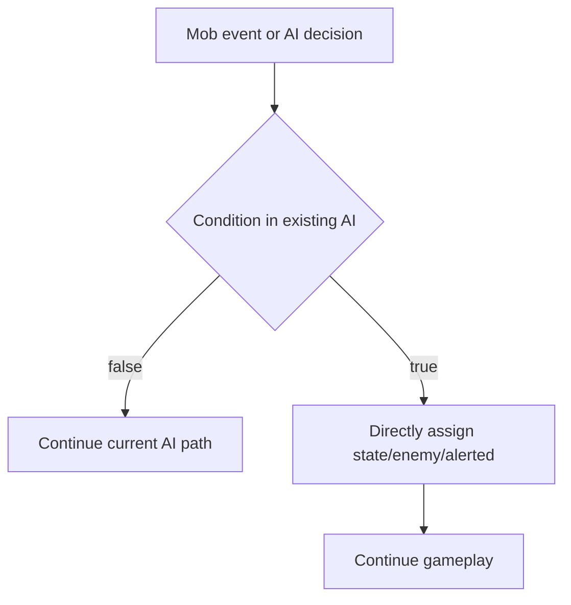
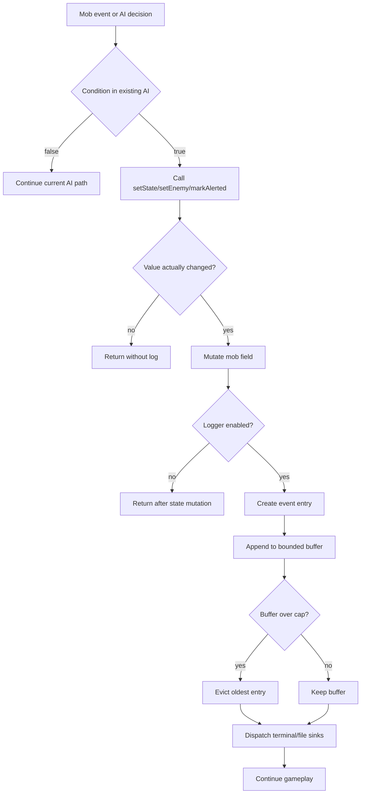
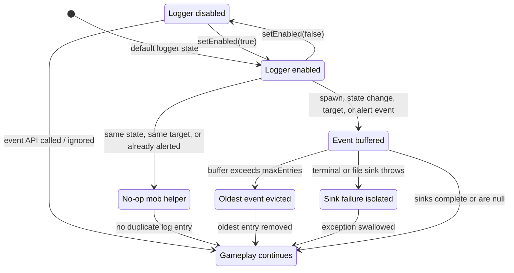
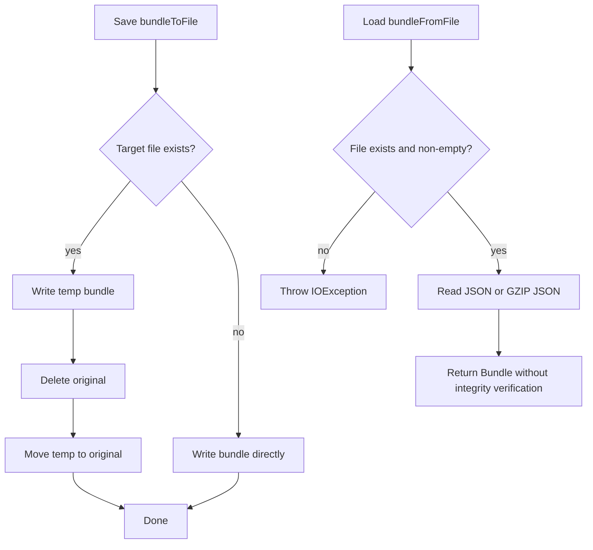
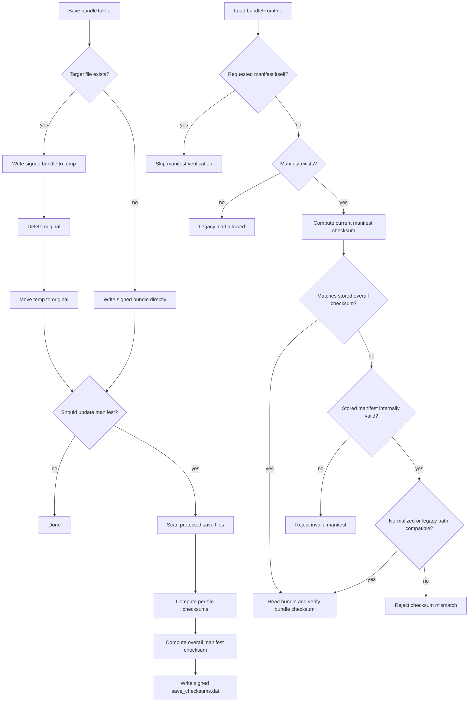
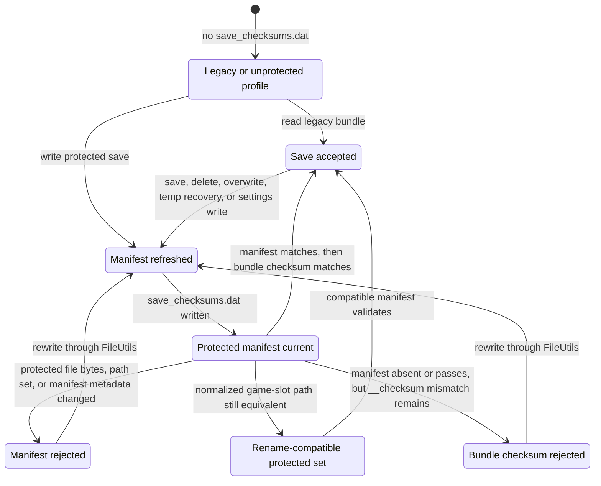
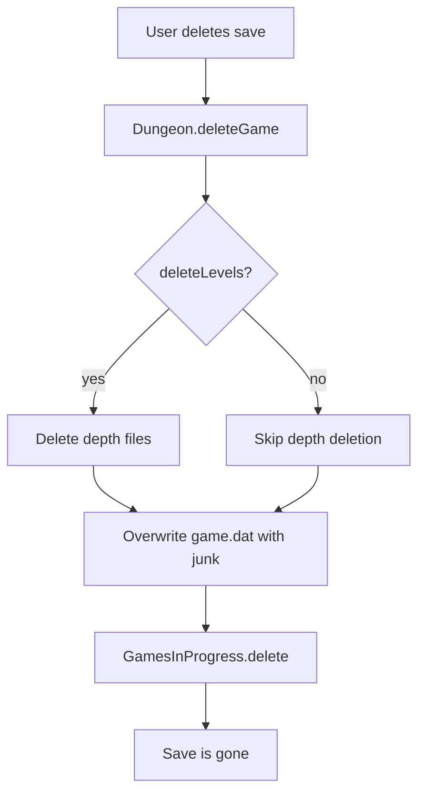
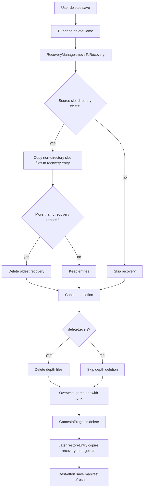
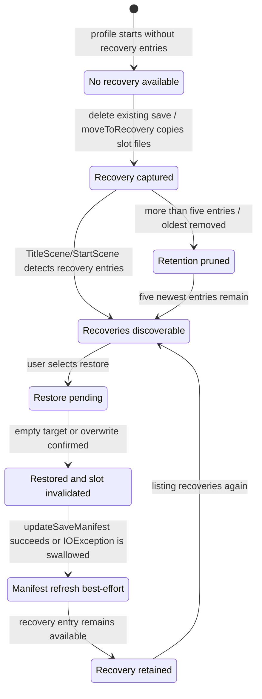

# Feature Complexity and Test Path Report

Project: `shattered-pixel-dungeon-3.0.2`  
Report scope: the three newly added Assignment 3 features, each compared against the first parent of the merge commit that introduced that feature.

Benchmark points:

| Feature | Feature merge | Benchmark parent | Main changed production files |
|---|---:|---:|---|
| Mob behaviour logging | `7a72358` | `7a72358^1` | `Mob.java`, `MobBehaviourLogger.java` |
| Save integrity checksum | `43c6f42` | `43c6f42^1` | `Bundle.java`, `FileUtils.java`, `GameSettings.java`, `CrashReportWriter.java` |
| Recovery saves | `7811326` | `7811326^1` | `Dungeon.java`, `RecoveryManager.java`, `TitleScene.java`, `StartScene.java`, `WndRecoverySave.java` |

Cyclomatic complexity is reported as `V(G) = decisions + 1`. Current method values are aligned with JaCoCo complexity where available. For files/classes that did not exist in the benchmark, the original complexity is `0`.

## Verification Checklist

- [x] Verified benchmark merge commits resolve locally: `7a72358`, `43c6f42`, `7811326`.
- [x] Checked the production files and tests referenced by this report against the current source tree.
- [x] Reconciled the test tables against every current `@Test` method and the generated JUnit XML result files.
- [x] Reconciled the complexity analysis against current source plus generated JaCoCo CSV/XML counters where the JaCoCo filters include the class.
- [x] Ran the assignment feature test command from `shattered-pixel-dungeon-3.0.2/`: `JAVA_HOME=/Library/Java/JavaVirtualMachines/amazon-corretto-17.jdk/Contents/Home GRADLE_USER_HOME=.gradle ./gradlew featureTest --no-daemon`.
- [x] Confirmed 172 tests pass: 56 core unit/performance, 18 core feature integration, 9 core cross-feature integration, 65 SPD-classes unit, 24 SPD-classes integration.
- [x] Regenerated scoped JaCoCo reports for `core` and `SPD-classes`.
- [x] Cross-checked report and README claims with independent agent reviews for feature facts, README commands, and coverage/Jacoco evidence.

Generated coverage artifacts:

- `core/build/reports/jacoco/test/html/index.html`
- `core/build/reports/jacoco/test/jacocoTestReport.xml`
- `core/build/reports/jacoco/test/jacocoTestReport.csv`
- `SPD-classes/build/reports/jacoco/test/html/index.html`
- `SPD-classes/build/reports/jacoco/test/jacocoTestReport.xml`
- `SPD-classes/build/reports/jacoco/test/jacocoTestReport.csv`

Current test inventory:

| Scope | Unit/performance tests | Feature integration tests | Cross-feature integration tests | Total | Source of validation |
|---|---:|---:|---:|---:|---|
| Core feature tests | 56 | 18 | 9 | 83 | `@Test` declarations and `core/build/test-results/**/TEST-*.xml` |
| SPD-classes feature tests | 65 | 24 | 0 | 89 | `@Test` declarations and `SPD-classes/build/test-results/**/TEST-*.xml` |
| **Total** | **121** | **42** | **9** | **172** | JUnit XML result files |

Current JaCoCo complexity cross-check:

| Scope | JaCoCo complexity result | Validation note |
|---|---:|---|
| `MobBehaviourLogger` including `Entry` | 31 total, 30 covered | Matches the report's claim that complexity is in the logger/helper layer; the one missed method is the real `defaultFileSink`, because tests use stub sinks. |
| `RecoveryManager` | 21 total, 21 covered | Matches the recovery complexity table and confirms all manager branches are covered. |
| Save-integrity filtered SPD classes | 328 total, 324 covered | Matches the filtered JaCoCo scope for `Bundle*`, `FileUtils*`, `GameSettings*`, and `CrashReportWriter*`. |

## 1. Mob Behaviour Logging

### Feature Summary

The benchmark implementation mutated mob AI state directly:

- `state = HUNTING`, `state = WANDERING`, `state = FLEEING`, `state = SLEEPING`
- `enemy = ...`
- `alerted = true`

The feature adds `MobBehaviourLogger` plus helper methods in `Mob`:

- `setState(AiState newState, String reason)`
- `setEnemy(Char newEnemy, String reason)`
- `markAlerted(String trigger)`

The existing AI decision structure is intentionally preserved. Most existing mob methods have the same branch structure, but selected mutation sites now pass through helper methods that add no-op checks and event emission. One direct allied-mob assignment remains (`ally.state = ally.WANDERING` in `Mob.java`) and is not counted as part of the logging instrumentation path.

### Changed Function Complexity

Important scope note: the mob behaviour logging feature does not add new decision points to the original AI state-machine logic. The existing `Mob` behaviours still make the same gameplay decisions as the benchmark; most changes replace direct field assignments with helper calls. The cyclomatic complexity increase is in newly added observational helpers and logger methods, not in the original AI control flow itself.

| Function or method group | Original V(G) | New V(G) | Increase | Analysis |
|---|---:|---:|---:|---|
| Existing `Mob` AI decision methods such as `act`, `chooseEnemy`, `Wandering.act`, `Hunting.act`, and `Fleeing.act` | unchanged | unchanged | 0 | Direct assignments were replaced by helper calls, but the gameplay branches and transitions remain the same. |
| Direct `state = ...` assignment sites in `Mob` | assignment only | delegated to `setState` | 0 in caller | Original sites had no local decision branch. The caller still follows the same path; helper complexity is counted separately. |
| `Mob.setState` | 0 | approx. 4 | +4 new helper | New observational helper. Paths: unchanged state return; changed state with non-null names; changed state with null old or new state. |
| Direct `enemy = ...` assignment sites in `Mob` | assignment only | delegated to `setEnemy` | 0 in caller | Assignment behaviour is preserved; target logging is delegated. |
| `Mob.setEnemy` | 0 | approx. 4 | +4 new helper | New observational helper. Paths: same target return; new non-null target; null target placeholder; target id extraction. |
| Direct `alerted = true` sites in `Mob` | assignment only | delegated to `markAlerted` | 0 in caller | Existing alert-triggering paths are preserved; duplicate-alert filtering is delegated. |
| `Mob.markAlerted` | 0 | approx. 2 | +2 new helper | New observational helper. Paths: already alerted return; first alert mutation and log. |
| `Mob.onAdd` | 2 | 2 | 0 | The existing `firstAdded` branch remains. The new log call is inside the existing true branch. |
| `MobBehaviourLogger.logSpawn/logStateChange/logAlert/logTarget` | 0 | 2 each | +2 each | New public event APIs. Each has enabled vs disabled paths. |
| `MobBehaviourLogger.record` | 0 | 2 | +2 | New ring-buffer append. Paths: below cap vs eviction while over cap. |
| `MobBehaviourLogger.dispatch` | 0 | 2 | +2 | New sink isolation. Paths: null sink return; sink call; thrown sink swallowed. |
| `MobBehaviourLogger.safe` | 0 | 2 | +2 | New null placeholder branch. |

Net effect: the containment statement is accurate for the original mob AI logic under instrumentation: no new branch is added to the existing gameplay decision flow at the logged mutation sites. At the whole-feature level, there is additional complexity because new helper/logger functions now exist and must be tested. This is a good containment pattern because the legacy state machine is not made harder to reason about at each logged mutation site.

### Original Flow Graph



### New Flow Graph



### FSM Diagram

The implemented logger FSM is intentionally high-level and observational. It is not a second AI state machine and it does not enforce an order such as spawn -> target -> hunting. Any supported event may arrive independently from the existing mob logic.



### Unit Test Path Definitions

Unit test files:

- `core/src/test/java/com/shatteredpixel/shatteredpixeldungeon/actors/mobs/MobBehaviourLoggerTest.java`
- `core/src/test/java/com/shatteredpixel/shatteredpixeldungeon/actors/mobs/MobBehaviourLoggerPerformanceTest.java`

| Unit test | Path exercised |
|---|---|
| `getInstance_returnsSameInstance` | Singleton accessor returns same static logger instance on repeated calls. |
| `getInstance_isNonNull` | Singleton accessor non-null path. |
| `enabledByDefault` | Constructor default enabled path. |
| `isEnabled_reflectsSetter` | Enabled -> disabled -> enabled setter/getter path. |
| `disabled_doesNotBuffer` | Disabled event API early-return path before buffer mutation. |
| `disabled_doesNotEmit` | Disabled event API early-return path before sink dispatch. |
| `reenable_keepsExistingEntries` | Enabled log path, disabled skip path, re-enabled append path. |
| `logSpawn_recordsCorrectEntry` | `logSpawn` enabled path through `record`. |
| `logStateChange_recordsTransition` | `logStateChange` path with `from -> to` details. |
| `logAlert_recordsTrigger` | `logAlert` path with trigger detail. |
| `logTarget_recordsTargetDetails` | `logTarget` path with target name and id. |
| `timestamp_isCurrent` | `record` timestamp creation path. |
| `entryToString_isInformative` | `Entry.toString` rendering path. |
| `sameState_doesNotDuplicateStateChangeLog` | `Mob.setState` no-op path: unchanged state returns without duplicate state-change event. |
| `sameEnemy_doesNotDuplicateTargetLog` | `Mob.setEnemy` no-op path: unchanged target returns without duplicate target event. |
| `alreadyAlerted_doesNotDuplicateAlertLog` | `Mob.markAlerted` no-op path: already-alerted mob returns without duplicate alert event. |
| `formattedLine_matchesPattern` | `format` path including timestamp and event fields. |
| `stateChangeLine_includesArrow` | State-change formatting path. |
| `sinksReceiveIdenticalLines` | Terminal and file sink fan-out path. |
| `newLogger_isEmpty` | Fresh buffer empty path. |
| `belowCap_growsLinearly` | Buffer append path below `maxEntries`. |
| `overCap_evictsOldest` | Buffer overflow path and FIFO eviction. |
| `shrinkingCap_trimsExisting` | `setMaxEntries` while-loop trim path. |
| `zeroCap_clampsToOne` | `setMaxEntries(0)` clamp path. |
| `negativeCap_clampsToOne` | `setMaxEntries(<0)` clamp path. |
| `clear_emptiesBuffer` | Buffer clear path. |
| `getEntries_isDefensiveCopy` | Defensive-copy path; external mutation does not affect buffer. |
| `terminalSink_calledOncePerEvent` | Terminal sink dispatch path. |
| `fileSink_calledOncePerEvent` | File sink dispatch path. |
| `fileSinkThrows_doesNotBreakLogger` | File sink exception catch path. |
| `terminalSinkThrows_doesNotBreakLogger` | Terminal sink exception catch path. |
| `nullSink_doesNotThrow` | Null sink early-return path in `dispatch`. |
| `swappingSink_redirects` | Sink replacement path. |
| `nullMobName_isHandled` | `safe(null)` for mob name. |
| `nullTargetName_isHandled` | `safe(null)` for target name. |
| `nullStateNames_areHandled` | `safe(null)` for state names. |
| `negativeIdsAccepted` | Negative id/position values accepted without validation failure. |
| `concurrentWrites_areThreadSafe` | Synchronized append path under concurrent writers. |
| `scriptedSequence_isCapturedInOrder` | End-to-end ordered event sequence path. |
| `disabledLogger_addsLessThanTenMicrosecondsPerEvent` | Performance guard path for disabled logging. |
| `enabledSpawnLogging_addsLessThanHundredMicrosecondsPerEvent` | Performance path for enabled spawn logging with stub sinks. |
| `enabledStateChangeLogging_addsLessThanHundredMicrosecondsPerEvent` | Performance path for enabled state-change logging with stub sinks. |
| `ringBufferAtCapacity_evictsOldestEntryWithinBudget` | Performance path for sustained eviction at buffer cap. |

### Integration Testing Analysis

Integration test file:

- `core/src/integrationTest/java/com/shatteredpixel/shatteredpixeldungeon/actors/mobs/MobBehaviourLoggerIntegrationTest.java`

Components analyzed:

- `Mob` lifecycle hook: `onAdd`
- `Mob` state helpers: `setState`, `setEnemy`, `markAlerted`
- Existing public mob actions: `aggro`, `clearEnemy`
- `MobBehaviourLogger` buffer and event sequencing
- A lightweight test mob/stub character arrangement inside the mob package

Structured suite:

| Integration test | Components crossed | Scenario structure |
|---|---|---|
| `onAdd_firesSpawnOnce` | `Mob.onAdd` + logger | First add -> spawn event. |
| `onAdd_calledTwice_firesOnceOnly` | `Mob.onAdd` idempotence + logger | First add logs; second add is silent. |
| `onAdd_afterRestore_doesNotFireSpawn` | Save-restore flag + `onAdd` | `firstAdded=false` -> no spawn event. |
| `setState_differentState_firesStateChange` | `Mob.setState` + logger | Different state -> state event. |
| `setState_sameState_isNoOp` | `Mob.setState` guard | Same state -> no event. |
| `aggro_firesBothTargetAndState` | `aggro`, `setEnemy`, `setState` | Aggro -> target assignment and hunting transition. |
| `setEnemy_newTarget_fires` | `setEnemy` + logger | New target -> target event. |
| `setEnemy_sameTarget_firesOnce` | `setEnemy` guard | Repeated target -> only first event. |
| `setEnemy_null_firesWithNonePlaceholder` | `setEnemy` null path | Non-null -> null target produces `<none>`. |
| `clearEnemy_afterAggro_firesBothEvents` | `aggro`, `clearEnemy`, `setState` | Aggro then clear -> null target and wandering transition. |
| `markAlerted_firesAlert` | `markAlerted` + logger | First alert -> alert event. |
| `markAlerted_alreadyAlerted_isNoOp` | `markAlerted` guard | Already-alerted mob -> no duplicate event. |
| `disabledLogger_silencesAllEvents` | Logger enabled flag + mob helpers | Disabled logger suppresses all events while mob helper calls still run. |

## 2. Save Integrity Checksum

### Feature Summary

The benchmark save pipeline wrote bundles and read bundles without persistent tamper evidence. The feature adds two integrity layers:

1. Bundle-level SHA-256 checksum stored inside each JSON bundle as `__checksum`.
2. Save-manifest checksum file `save_checksums.dat` that tracks protected save files, normalized game slot paths, file checksums, and an overall checksum.

The feature also adds settings manifest refresh and crash-report writing support used by the reliability work.

### Changed Function Complexity

| Function or method group | Original V(G) | New V(G) | Increase | Analysis |
|---|---:|---:|---:|---|
| `Bundle.read` | approx. 6 in one method | `read` 1 + `readJSONObject` 6 + `verifyChecksum` 4 | +5, split across helpers | Original parsing path moved to `readJSONObject`; checksum verification adds no-checksum, malformed checksum, mismatch, and valid paths. |
| `Bundle.write` | 2 | 2 + signing helpers | helper cost | Compression branch remains. New complexity is in canonical signing helpers. |
| `Bundle.readChecksum` | 0 | 2 | +2 | New helper. Paths: checksum absent; checksum present and valid. |
| `Bundle.verifyChecksum` | 0 | 4 | +4 | New helper. Paths: no checksum, non-string checksum, mismatch, valid removal. |
| `Bundle.appendObject` | 0 | 11 | +11 | New canonical JSON object writer. Branches cover root checksum exclusion/insertion, key iteration, separator placement, checksum override. |
| `Bundle.appendArray` | 0 | 3 | +3 | New canonical array writer. Paths cover empty/non-empty and separators. |
| `Bundle.appendValue` | 0 | 7 | +7 | New typed-value dispatcher for null, object, array, number/boolean, and string values. |
| `FileUtils.cleanTempFiles()` | 1 | 2 | +1 | Adds manifest refresh only when temp files were found. |
| `FileUtils.deleteFile` | 1 | 2 | +1 | Adds manifest refresh only when deletion succeeds. |
| `FileUtils.overwriteFile` | 1 | 1 | 0 | Adds best-effort manifest refresh without additional branch complexity in JaCoCo. |
| `FileUtils.bundleFromFile` | 4 | 4 | 0 local | Adds manifest verification call before existing file validation; complexity is in `verifySaveManifest`. |
| `FileUtils.bundleToFile` private overload | 2 | 4 | +2 | Adds manifest-refresh decision and manifest-file self-exclusion. |
| `FileUtils.updateSaveManifest` | 0 | 6 | +6 | New method. Paths: unconfigured/noop, recursive guard/noop, invalid root/noop, normal manifest write, finally reset. |
| `FileUtils.verifySaveManifest` | 0 | 11 | +11 | New method. Paths: manifest self-read, missing manifest, invalid shape, valid exact match, invalid stored overall checksum, normalized rename compatibility, legacy bundle checksum compatibility, mismatch rejection. |
| `FileUtils.collectManifestFiles` | 0 | 7 | +7 | New recursive scanner. Paths: active game dir recursion, ignored directory, protected file, unprotected file. |
| `FileUtils.isManifestProtectedFile` | 0 | 9 | +9 | New filter. Paths: temp/manifest exclusion, root `.dat`, settings file, active game slot `.dat`, nested/unsupported rejection. |
| `FileUtils.isActiveGameDir` | 0 | 6 | +6 | New slot-folder recognizer. Paths: bad prefix, bare `game`, numeric suffix, non-digit suffix. |
| `FileUtils.manifestEntriesFromManifest` | 0 | 6 | +6 | New parser. Paths: missing arrays, length mismatch, normalized paths, raw paths, sorting. |
| `FileUtils.legacyManifestFileChecksum` | 0 | 4 | +4 | New compatibility path for bundle checksums inside `.dat` files. |
| `GameSettings.put*` | 1 each | 1 each | 0 | Direct `flush()` calls replaced by shared `flush`. |
| `GameSettings.flush` | 0 | 1 | +1 | New shared flush and best-effort manifest refresh. |
| `CrashReportWriter` component | 0 | outer class 39 + `GdxReportStore` 14 | +53 combined | New reliability component. Main complexity is report write failure containment, filename collision handling, truncation, platform/thread fallback, and GDX store failures. |

### Original Flow Graph



### New Flow Graph



### FSM Diagram

At a high level, protected reads are guarded by the manifest before `Bundle.read` verifies the bundle-level `__checksum`. Therefore an external edit to a protected save is normally reported as a manifest rejection first; the bundle checksum still protects direct `Bundle.read` calls, legacy/no-manifest loads, and reads where manifest validation passes.



### Unit Test Path Definitions

Unit test files:

- `SPD-classes/src/test/java/com/watabou/utils/BundleTest.java`
- `SPD-classes/src/test/java/com/watabou/utils/CrashReportWriterTest.java`
- `SPD-classes/src/test/java/com/watabou/utils/FileUtilsTest.java`
- `SPD-classes/src/test/java/com/watabou/utils/GameSettingsTest.java`

| Unit test | Path exercised |
|---|---|
| `BundleTest.writesChecksumAndRemovesItAfterRead` | Signed write path and checksum removal after read. |
| `BundleTest.readsSaveWithoutChecksum` | Legacy bundle path with no checksum. |
| `BundleTest.compressedSaveRoundTripsWithChecksum` | GZIP write/read path with checksum verification. |
| `BundleTest.gzipDetectionRequiresBothMagicBytes` | Partial GZIP magic bytes are not misdetected as compressed saves. |
| `BundleTest.legacyLibGdxJsonSaveFallsBackWhenStrictJsonParsingFails` | Legacy libGDX JSON fallback path. |
| `BundleTest.readRejectsStrictJsonThatIsNotAnObjectOrArray` | Strict JSON root type rejection path. |
| `BundleTest.rejectsSaveWithChecksumMismatch` | Tampered bundle mismatch rejection path. |
| `BundleTest.checksumDoesNotDependOnInsertionOrder` | Canonical key ordering path. |
| `BundleTest.checksumCoversNestedObjectsArraysBooleansAndNulls` | Canonical object, array, boolean, and null paths. |
| `BundleTest.nestedChecksumNamedFieldsAreTreatedAsRegularData` | Nested `__checksum` fields are treated as ordinary nested data. |
| `BundleTest.checksumChangesWhenContentChanges` | Content mutation changes checksum path. |
| `BundleTest.readChecksumReturnsBundleChecksum` | `readChecksum` present-checksum path. |
| `BundleTest.readChecksumReturnsNullForLegacyBundle` | `readChecksum` absent-checksum path. |
| `BundleTest.readChecksumRejectsMalformedChecksumField` | Non-string checksum rejection path. |
| `BundleTest.primitiveValuesClassesKeysAndRemovalRoundTrip` | Primitive put/get, class, key listing, and remove paths. |
| `BundleTest.arrayValuesRoundTripForAllSupportedTypes` | Array serialization and typed array getters. |
| `BundleTest.putMethodsReportJsonExceptionsWhenBackingObjectRejectsWrites` | Bundle put exception-reporting paths. |
| `BundleTest.nestedBundlesRootArraysAndBundleArraysAreReadable` | Nested bundle and root array reading paths. |
| `BundleTest.bundlableObjectsCollectionsAndAliasesRestore` | Bundlable restore, collection restore, and alias path. |
| `BundleTest.unrestorableBundlablesReturnNullOrAreSkipped` | Unrestorable bundlable fallback and skip paths. |
| `BundleTest.classAliasesAndInvalidObjectsUseFallbacks` | Alias lookup, invalid class, and fallback paths. |
| `BundleTest.missingMalformedValuesReturnFallbacks` | Malformed/missing value fallback paths. |
| `BundleTest.writeReturnsFalseWhenOutputStreamFails` | Bundle write exception path. |
| `BundleTest.legacyLibGdxJsonDuplicateKeysArePrunedRecursively` | Legacy libGDX JSON fallback and duplicate-key pruning path. |
| `BundleTest.canonicalValueWriterHandlesJavaNull` | Canonical writer Java-null path. |
| `BundleTest.checksumReportsMissingSha256ProviderAsIOException` | Missing SHA-256 provider is wrapped as `IOException`. |
| `CrashReportWriterTest.writesReportForHandledException` | Normal handled-exception report write path. |
| `CrashReportWriterTest.handlesNullThrowableAndNullMessage` | Null throwable/message fallback path. |
| `CrashReportWriterTest.preservesFullStackTraceAndCauseChain` | Full stack and cause-chain rendering path. |
| `CrashReportWriterTest.createsUniqueSortableFilenames` | Filename counter and sortable timestamp path. |
| `CrashReportWriterTest.truncatesOversizedReports` | Oversized report truncation path. |
| `CrashReportWriterTest.writeFailureDoesNotMaskOriginalException` | Store write failure containment path. |
| `CrashReportWriterTest.nullConfigurationAndReentrantWriteReturnNull` | No configured store and reentrant guard paths. |
| `CrashReportWriterTest.writeReportReturnsNullWhenAllCandidateNamesAlreadyExist` | Filename collision exhaustion path. |
| `CrashReportWriterTest.runtimeFailureFromStoreReturnsNull` | Unexpected store runtime failure path. |
| `CrashReportWriterTest.gdxConfiguredStoreWritesToCrashReportDirectory` | GDX-backed store success path. |
| `CrashReportWriterTest.gdxConfiguredStoreWritesToExistingCrashReportDirectory` | Existing crash report directory path. |
| `CrashReportWriterTest.gdxConfiguredStoreRejectsReportDirectoryThatIsAFile` | Report directory is file rejection path. |
| `CrashReportWriterTest.gdxConfiguredStoreHandlesDirectoryCreationWriteMoveDeleteAndExistsFailures` | GDX store directory/write/move/delete/exists failure paths. |
| `CrashReportWriterTest.platformNameIsWrittenWhenGdxAppIsAvailable` | Platform lookup success path. |
| `CrashReportWriterTest.platformLookupFailureFallsBackToUnknown` | Platform lookup exception fallback path. |
| `CrashReportWriterTest.nullPlatformFallsBackToUnknown` | Null platform fallback path. |
| `CrashReportWriterTest.unknownVersionAndNullTypeUseFallbackReportValues` | Unknown version and null report type fallback path. |
| `CrashReportWriterTest.writeReportPersistsHandledReportThroughWriter` | Writer store persistence path. |
| `CrashReportWriterTest.utf8TruncationHelpersHandleEmptyAndPartialCharacters` | UTF-8 truncation edge cases. |
| `FileUtilsTest.protectedBundleWriteCreatesSaveManifest` | Protected bundle write creates `save_checksums.dat`. |
| `FileUtilsTest.manifestStoresProtectedFilePathsCorrectly` | Manifest includes the expected protected paths. |
| `FileUtilsTest.manifestExcludesRecoveryDirectoryFiles` | Recovery files are excluded from manifest protection scope. |
| `FileUtilsTest.manifestUpdatesAfterSaveOverwriteOrDelete` | Overwrite/delete refreshes manifest state. |
| `FileUtilsTest.cleanTempFilesReturnsFalseWhenNothingWasRecovered` | Temp cleanup no-op path. |
| `FileUtilsTest.fileDirectoryHelpersHandleEmptyFilesDirectoriesAndNullHandles` | File helper defensive paths. |
| `FileUtilsTest.cleanTempFilesCombinesRecursiveRecoveryResultsAcrossDirectories` | Recursive temp cleanup aggregation path. |
| `FileUtilsTest.fileActionsSwallowManifestRefreshIoFailuresAfterPrimaryAction` | Primary action succeeds despite manifest refresh failure. |
| `FileUtilsTest.getFileHandleReturnsNullForUnmappedFileTypeSwitchEntry` | Unmapped file type fallback path. |
| `FileUtilsTest.bundleToManifestFileDoesNotRecursivelyRefreshManifest` | Manifest self-write recursion guard. |
| `FileUtilsTest.updateSaveManifestNoopsWhenRootIsMissingOrNull` | Missing/null root no-op paths. |
| `FileUtilsTest.emptyOrDirectoryManifestKeepsLegacyReadsCompatible` | Empty/directory manifest legacy compatibility. |
| `FileUtilsTest.malformedManifestMetadataRejectsProtectedReads` | Malformed manifest rejection path. |
| `FileUtilsTest.manifestPathHelpersClassifyOnlyActiveTopLevelGameFiles` | Protected path classifier edge cases. |
| `GameSettingsTest.lazyInitializesPreferencesFromGdxApp` | Lazy preference initialization path. |
| `GameSettingsTest.containsAndGettersReturnStoredOrDefaultValues` | Normal preference getter paths. |
| `GameSettingsTest.numericGettersClampOutOfRangeValuesAndPersistClamp` | Integer/long range clamp and persistence paths. |
| `GameSettingsTest.stringGetterRejectsOverLengthValuesAndPersistsDefault` | Overlength string rejection path. |
| `GameSettingsTest.getterExceptionsReturnDefaultsAndResetRecoverableValues` | Preference exception fallback paths. |
| `GameSettingsTest.putMethodsFlushAfterEachSupportedSettingType` | All put overloads -> shared flush path. |

### Integration Testing Analysis

Integration test file:

- `SPD-classes/src/integrationTest/java/com/watabou/utils/FileUtilsSaveManifestIntegrationTest.java`

Components analyzed:

- `FileUtils.bundleToFile`, temp-file replacement, protected file scanning, manifest creation
- `FileUtils.bundleFromFile`, manifest validation, path normalization, legacy compatibility
- `Bundle.write`, `Bundle.read`, `Bundle.readChecksum`
- `GameSettings.flush` and preference persistence
- File system interactions through libGDX `FileHandle`
- Failure simulation for tampering, missing files, GDX failures, and unavailable SHA-256 provider

Structured suite:

| Integration test | Components crossed | Scenario structure |
|---|---|---|
| `bundleWritesCreateManifestAndDetectExternalTampering` | `bundleToFile`, manifest write, `bundleFromFile` | Save -> manifest created -> external edit -> load rejected -> save refreshes manifest. |
| `manifestIncludesOnlyProtectedSaveFilesInStableOrder` | scanner, filters, sorting | Mixed files/directories -> protected paths only -> stable sorted manifest. |
| `fileHelpers_resolveReadAndWriteAcrossAllSupportedFileTypes` | `getFileHandle`, file helpers | Exercise supported file types and file helper behaviours. |
| `randomByteFlipsInAllGameSaveFilesAreRejected` | manifest + bundle checksum | Write save set -> mutate bytes -> every protected save rejects. |
| `renamingGameRootFolderKeepsManifestValid` | path normalization | Rename `gameN` root -> normalized path remains compatible. |
| `rawGamePathManifestStaysCompatibleAfterSlotRename` | path normalization | Raw game paths remain compatible after slot rename. |
| `legacyBundleChecksumManifestStaysCompatibleWithSignedSaveFiles` | legacy compatibility | Legacy bundle-checksum manifest remains compatible with signed saves. |
| `renamingProtectedGameSaveFileIsRejected` | protected path validation | Rename protected file -> manifest mismatch rejection. |
| `movingRootSaveFileIntoGameFolderIsRejected` | path normalization and protected-file set | Move root save into slot folder -> mismatch rejection. |
| `blindJsonValueEditWithStaleChecksumIsRejected` | manifest first, bundle checksum fallback | Protected JSON value edit without recomputing checksums -> manifest rejection before bundle parsing. |
| `deleteFileAndOverwriteFile_refreshManifestAfterPrimaryAction` | delete/overwrite helpers + manifest refresh | File deletion and overwrite update manifest state. |
| `cleanTempFilesRefreshesManifestAfterRecoveringNewerTempFile` | temp recovery + manifest refresh | Newer valid temp replaces original and refreshes manifest. |
| `cleanTempFilesDeletesEmptyFilesInvalidTempsAndOlderTemps` | temp cleanup branches | Empty, invalid, and older temp cleanup paths. |
| `cleanTempFilesReplacesInvalidOriginalAndRecursesIntoSubdirectories` | recursive cleanup | Invalid original replaced from temp inside subdir traversal. |
| `fileOperationsSwallowManifestRefreshFailuresAfterPrimaryAction` | failure containment | Primary delete/overwrite succeeds even if manifest refresh fails. |
| `updateManifestNoopsWhenFileUtilsIsNotReadyOrAlreadyUpdating` | manifest guard paths | Unconfigured and reentrant manifest update returns safely. |
| `bundleFromFileRejectsMissingEmptyDirectoryAndGdxFailures` | read failure paths | Missing, empty, directory, and GDX failure rejection. |
| `bundleToFileOverwritesExistingFileThroughTempFile` | temp write/replace path | Existing file is overwritten through temp move. |
| `bundleToFileWrapsGdxWriteFailuresAsIoExceptions` | write failure wrapping | GDX write failure becomes `IOException`. |
| `bundleFromFile_rejectsInvalidManifestShapes` | manifest parser/validator | Missing overall checksum, array mismatch, bad overall checksum rejected. |
| `manifestSortsDuplicateNormalizedPathsByChecksum` | sorting comparator | Duplicate normalized paths sorted by checksum. |
| `manifestRefreshAndBundleRead_wrapUnavailableSha256Provider` | checksum helper exception path | Missing provider is wrapped as `IOException`. |
| `gameSettingsWritesRefreshManifestForEachSupportedType` | `GameSettings.put*` + manifest | Preference writes refresh manifest for each supported type. |
| `gameSettingsFlushDoesNotPropagateManifestUpdateFailures` | `GameSettings.flush` containment | Manifest update failure is reported but not propagated. |

## 3. Recovery Saves

### Feature Summary

The benchmark deletion flow permanently overwrote/deleted save files. The feature inserts a soft-delete recovery step before destructive deletion:

- `Dungeon.deleteGame` calls `RecoveryManager.moveToRecovery(save)` before overwriting/deleting.
- `RecoveryManager` copies flat save-slot files to `recovery/<timestamp>_<slot>/`.
- Only the five newest recovery entries are retained.
- `TitleScene` routes to `StartScene` when recovery entries exist, even if there are no active saves.
- `StartScene` displays a Recover button when recoveries exist.
- `WndRecoverySave` lists recoveries and restores each entry to its original slot, confirming overwrite when necessary. The lower-level `RecoveryManager.restoreEntry` API can restore to any caller-provided target slot.

### Changed Function Complexity

| Function or method group | Original V(G) | New V(G) | Increase | Analysis |
|---|---:|---:|---:|---|
| `Dungeon.deleteGame` | approx. 3 | approx. 3 | 0 | New recovery call is linear and before existing `deleteLevels` branch. Deletion branch complexity is unchanged. |
| `RecoveryManager.moveToRecovery` | 0 | 2 | +2 | New method. Paths: source slot missing return; source exists -> copy -> prune. |
| `RecoveryManager.listRecoveryEntries` | 0 | 4 | +4 | New method. Paths: iterate recovery dir, keep directories, ignore files/malformed entries, sort. |
| `RecoveryManager.restoreEntry` | 0 | 1 by JaCoCo; 2 operational outcomes | +1 new method | New method. Deletes the target, copies the recovery entry, marks the slot unknown, then refreshes the save manifest best-effort. Source/path analysis includes manifest-refresh success and swallowed `IOException`; JaCoCo reports the method as linear because the catch block is not counted as a branch in the generated counter. |
| `RecoveryManager.slotFromEntryName` | 0 | 4 | +4 | New method. Paths: malformed name, matching slot, non-matching slots, unknown return. |
| `RecoveryManager.isRecoveryEntryName` | 0 | 4 | +4 | New helper. Paths: missing separator, non-numeric timestamp, missing/invalid slot folder, valid entry. |
| `RecoveryManager.copyGameDir` | 0 | 3 | +3 | New method. Paths: iterate files, copy non-directory, skip directory. |
| `RecoveryManager.pruneOldEntries` | 0 | 2 | +2 | New method. Paths: under/equal cap, over cap loop deleting oldest. |
| `TitleScene` enter-button branch | existing | +1 local branch | +1 | Adds recovery-aware routing: no saves and no recoveries starts hero selection; no saves but recoveries routes to `StartScene` so the Recover button is reachable. |
| `StartScene.create` recovery block | existing | +1 local branch | +1 | Adds `if recoveries exist` and button creation/click path. |
| `WndRecoverySave` constructor | 0 | approx. 4 | +4 | New UI. Paths: entries iteration, invalid entry skip, timestamp/age formatting, restore button creation. |
| `WndRecoverySave.onRestoreClicked` | 0 | 2 | +2 | New UI. Paths: target occupied confirmation vs direct restore. |
| `WndRecoverySave.timestampFromEntry` | 0 | 3 | +3 | New helper. Paths: bad split, parse success, parse failure. |
| `WndRecoverySave.formatAge` | 0 | 4 | +4 | New helper. Paths: just now, minutes, hours, days. |

### Original Flow Graph



### New Flow Graph



### FSM Diagram

The recovery FSM is abstracted around lifecycle state, not individual UI widgets. UI states are only called out where they change the lifecycle: discoverability of recoveries and overwrite confirmation.



### Unit Test Path Definitions

Unit test file:

- `core/src/test/java/com/shatteredpixel/shatteredpixeldungeon/RecoveryManagerTest.java`

| Unit test | Path exercised |
|---|---|
| `constructor_canBeInstantiated` | Public constructor smoke path for testability of the manager class. |
| `slotFromEntryName_validEntry_returnsCorrectSlot` | Valid timestamp/slot entry name -> slot number. |
| `slotFromEntryName_nameWithoutUnderscore_returnsNegativeOne` | Malformed name -> `-1`. |
| `slotFromEntryName_unknownSlotFolder_returnsNegativeOne` | Unknown slot folder -> loop exhausts -> `-1`. |
| `listRecoveryEntries_noRecoveryDirectory_returnsEmptyList` | Missing recovery directory -> empty list. |
| `listRecoveryEntries_multipleEntries_sortedOldestFirst` | Directory entries returned sorted ascending by timestamp prefix. |
| `listRecoveryEntries_ignoresFilesInRecoveryDirectory` | File entries skipped; only directories listed. |
| `listRecoveryEntries_ignoresMalformedEntryDirectories` | Malformed directory names skipped. |
| `moveToRecovery_nonExistentSourceSlot_doesNothing` | Missing source slot -> early return and no recovery entry. |
| `moveToRecovery_existingSlot_createsRecoveryEntryWithFiles` | Existing slot -> recovery entry with flat save files. |
| `moveToRecovery_existingSlot_skipsNestedDirectories` | Existing slot with nested dir -> flat files copied, nested dir skipped. |
| `restoreEntry_ignoresManifestUpdateIOException` | Restore succeeds when best-effort manifest refresh fails. |
| `moveToRecovery_prunesOldestEntryWhenMoreThanFiveEntriesExist` | Repeated deletes -> retention pruning removes oldest entry. |

### Integration Testing Analysis

Integration test file:

- `core/src/integrationTest/java/com/shatteredpixel/shatteredpixeldungeon/RecoverySavesIntegrationTest.java`

Components analyzed:

- `RecoveryManager.moveToRecovery`
- `RecoveryManager.listRecoveryEntries`
- `RecoveryManager.restoreEntry`
- `RecoveryManager` retention pruning
- `FileUtils` directory/file operations
- `GamesInProgress.gameFolder` and slot invalidation through `GamesInProgress.setUnknown`
- Temporary file system fixture representing game save slots

Structured suite:

| Integration test | Components crossed | Scenario structure |
|---|---|---|
| `moveToRecoveryThenRestore_preservesFileContentIntact` | move, list, restore, file bytes | Create slot -> move to recovery -> delete slot -> restore -> bytes match. |
| `restoreEntry_copiesSelectedRecoveryEntryToTargetSlot` | multiple moves, sorted list, restore | Recoveries for slots 1/2/3 -> restore selected recovery into target slot. |
| `restoreEntry_overwritesOccupiedTargetSlot` | restore, target cleanup | Recovery restored into occupied slot -> occupant file removed. |
| `moveToRecovery_prunesOldestEntryWhenRetentionLimitExceeded` | move, prune, sort | Six recovery creations -> five remain -> oldest removed -> order preserved. |
| `restoreEntry_doesNotDeleteRecoveryEntry` | restore and list | Restore recovery into slot -> recovery entry still listed afterward. |

## Cross-Feature Observations

| Feature | Complexity placement | Testing strength |
|---|---|---|
| Mob behaviour logging | Existing AI state-machine branches are preserved; added complexity is isolated in new observational helpers and logger code. | Strong unit coverage for logger internals and integration coverage for mob instrumentation paths. |
| Save integrity checksum | Highest complexity increase, especially manifest validation and canonical JSON. | Broadest integration suite; tests tampering, legacy compatibility, path normalization, failure containment, and settings interaction. |
| Recovery saves | Moderate complexity, mostly new and localized in `RecoveryManager` and restore UI. | Unit tests cover manager edge cases; integration tests cover end-to-end file preservation, restore, overwrite, retention, and manifest-refresh failure containment. |

### Cross-Feature Integration Tests

Integration test file:

- `core/src/integrationTest/java/com/shatteredpixel/shatteredpixeldungeon/actors/mobs/MergedFeatureIntegrationTest.java`

This suite contains the 9 cross-feature integration tests. They are counted separately from the 42 single-feature integration tests in the inventory above.

| Integration test | Features crossed | Scenario structure |
|---|---|---|
| `saveWriteThenMobLog_keepsManifestValidAndIgnoresLogFile` | Mob logging + save integrity | Write protected save -> enable real mob log file sink -> emit mob events -> read manifest -> assert only protected save files are tracked, not the diagnostic log. |
| `deleteToRecovery_thenRestore_preservesChecksumReadableSave` | Recovery + save integrity | Write protected slot -> move it to recovery -> delete active slot -> restore recovery -> load restored bundle through manifest and bundle checksum validation. |
| `restoredSaveTampering_isRejectedAfterRecoveryRestore` | Recovery + save integrity | Restore a protected save -> edit restored bytes externally -> protected read rejects the stale restored file. |
| `mobLogBeforeDelete_isCopiedOnlyIfInsideSlotAndDoesNotBreakRecovery` | Mob logging + recovery + manifest filtering | Create slot-local diagnostic log -> move slot to recovery -> restore -> confirm log can be copied with the slot while remaining outside manifest protection scope. |
| `recoveryDirectoryContents_areExcludedFromSaveManifest` | Recovery + save integrity | Create recovery entries beside active saves -> refresh/read manifest -> assert recovery directory contents are excluded from protected save-file checks. |
| `multipleRecoveredSlots_restoreChosenEntryAndManifestValidatesTarget` | Recovery + save integrity | Create multiple recovered slots -> select one entry -> restore into the target slot -> read the target through manifest validation to prove the selected entry, not another recovery, was restored. |
| `loggerSinkFailure_doesNotPreventSaveManifestOrRecoveryWorkflow` | Mob logging + recovery + save integrity | Configure a throwing logger sink -> emit mob events -> write save -> move and restore recovery -> assert logger failure is isolated from save manifest and recovery workflows. |
| `helperDeletionWorkflow_updatesManifestAndRecoveryKeepsOriginalBytes` | Recovery + save integrity | Move original slot to recovery -> delete active slot through `FileUtils` -> manifest updates for active files -> recovery copy still preserves the original bytes. |
| `deleteGameRestoreLoadThenTamper_lifecycleKeepsRecoveryReadableAndRejectsTamper` | All three | Emit mob logs -> delete through `Dungeon.deleteGame` -> restore recovery -> load restored save successfully -> tamper afterward -> protected read rejects the tampered save. |

### Latest Test Evidence

Latest local verification rerun on 2026-05-24:

```bash
cd shattered-pixel-dungeon-3.0.2
JAVA_HOME=/Library/Java/JavaVirtualMachines/amazon-corretto-17.jdk/Contents/Home GRADLE_USER_HOME=.gradle ./gradlew featureTest --no-daemon
```

Result: **BUILD SUCCESSFUL**. The test and JaCoCo tasks were up to date on this rerun; the generated JUnit XML artifacts record **172 tests passed**, with 0 failures, 0 errors, and 0 skipped tests.

| Suite | Tests |
|---|---:|
| `:core:test` | 56 |
| `:core:integrationTest` feature integration | 18 |
| `:core:integrationTest` cross-feature integration | 9 |
| `:SPD-classes:test` | 65 |
| `:SPD-classes:integrationTest` | 24 |
| **Total** | **172** |

Latest scoped JaCoCo evidence from `featureTest`:

| Scope | Classes included by JaCoCo filter | Line coverage | Branch coverage | Instruction coverage |
|---|---|---:|---:|---:|
| Mob behaviour logging | `MobBehaviourLogger*` | 96.0% | 100.0% | 95.8% |
| Recovery saves | `RecoveryManager*` | 100.0% | 100.0% | 100.0% |
| Save integrity checksum | `Bundle*`, `FileUtils*`, `GameSettings*`, `CrashReportWriter*` | 100.0% | 98.9% | 99.9% |

Important coverage scope note: `core/build.gradle` filters JaCoCo to `MobBehaviourLogger*` and `RecoveryManager*`. It does not include the full upstream game or UI/scene classes such as `Dungeon`, `TitleScene`, `StartScene`, and `WndRecoverySave`. Those UI and lifecycle paths are covered by source review and by integration-path tests where the headless suite can reach the underlying manager APIs, but their line coverage is not represented in the filtered coverage percentages.
